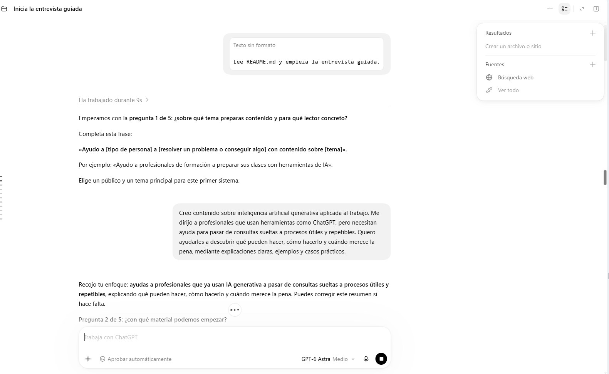

# Crea tu sistema editorial con IA · Think&Hack

Soy **Aina Lluna**, creadora de [Think&Hack](https://ainalluna.substack.com/), donde comparto cómo aplico la IA a procesos de trabajo, con ejemplos y casos prácticos.

Este es el material de mi ponencia **«De chat a sistema: cómo las skills convierten la IA en tu equipo de marketing»**, para [ConIA Digital](https://conia.digital/), en Madrid, el 17 de octubre de 2026. Puedes consultar la [presentación de la ponencia](https://docs.google.com/presentation/d/18gthpXMVpU_P2g2LwNjFf7nDvIgb5ctnc1NFNk_2pHE/edit?slide=id.h7cfcbfaf388ee8c6_15_99#slide=id.h7cfcbfaf388ee8c6_15_99).

El punto de partida es el sistema editorial de Think&Hack. El método consiste en definir el proceso antes de construir: qué buscamos, qué información necesitamos, qué hace cada skill y qué decisiones conservamos las personas. Después construimos por etapas y comprobamos cada resultado. Aquí puedes aplicar ese método a tu propio caso, empezando por un sistema que llega hasta el documento madre.

Si quieres seguir mis pruebas y aprender a crear tus propios sistemas de IA, [lee y suscríbete a Think&Hack](https://ainalluna.substack.com/).

Este material te guía para diseñar y construir un sistema editorial adaptado a tu trabajo. Empiezas con dos archivos, respondes cinco preguntas y el agente crea tu arquitectura. Después lo construyes paso a paso.

**Al terminar conservarás tu arquitectura y todos los prompts para volver a construirlo.** Consulta [dónde quedan los materiales y cómo reutilizarlos](#7-dónde-están-los-materiales-y-cómo-reutilizarlos).

El sistema seguirá este recorrido:

**Recuperar datos → analizar lo publicado → encontrar oportunidades → investigar y abrir nuevos ángulos → redactar un documento madre.**

El documento madre reúne la explicación, los hallazgos, ejemplos y fuentes para producir después newsletters, posts y otras piezas. La producción por canal y la voz de marca quedan para otro proceso.

## Qué entendemos por una oportunidad

Una oportunidad es **un tema y un subtema que interesan a tu lector y que todavía no has desarrollado, o que puedes ampliar con una aportación concreta**. El sistema los obtiene cruzando las fuentes con tu histórico.

**Fichas de artículos y vídeos → matriz de proximidad → dos propuestas de tema y subtema.**

### 1. Fichas comparables

El agente lee cada artículo y cada transcripción seleccionada y extrae la misma información:

| Campo | Qué contiene |
|---|---|
| Tema | El asunto principal. |
| Subtemas | Los aspectos concretos que trata. |
| Entidades | Herramientas, personas, productos y conceptos relevantes, con nombres consistentes. |
| Idea principal | Qué sostiene o explica la fuente, en una frase. |
| Referencias | Enlace, fecha y pasajes o minutos que respaldan los subtemas. |

Por ejemplo, «Agentes de IA» es un tema; «Agentes compartidos entre compañeros», un subtema; «Kylon», una entidad. Las etiquetas se reutilizan cuando significan lo mismo. No tienes que mantener categorías ni mapas a mano.

### 2. Matriz de proximidad

Para cada subtema externo, el sistema busca los artículos propios más cercanos y comprueba sus pasajes. Guarda y muestra una tabla breve:

| Tema / subtema encontrado | Fuente | Artículos propios relacionados | Proximidad | Qué queda por tratar |
|---|---|---|---|---|
| Tema y aspecto concreto | Vídeo y minuto | Títulos enlazados | Alta, media o baja | Diferencia en una frase |

**Alta:** ya desarrollaste ese subtema con una idea equivalente. **Media:** trataste el tema, pero falta ese aspecto o una aportación nueva. **Baja:** no se localizó un desarrollo equivalente en el histórico consultado. Si falta material para comparar, indicará **pendiente**. Son categorías de comparación, no porcentajes inventados ni medidas de demanda.

Compartir una herramienta no significa repetir una idea. Tampoco basta cambiar el nombre de la herramienta para tener un tema nuevo. La matriz se genera desde las fichas y las referencias; no se rellena después para justificar títulos ya inventados.

### 3. Dos propuestas breves para elegir

El sistema prioriza los subtemas que encajan con tu lector y aportan algo respecto al histórico. Te entrega **dos propuestas**, con este formato:

| Tema | Subtema propuesto | Por qué interesa y qué aporta | Fuente |
|---|---|---|---|
| Tema 1 | Aspecto concreto que desarrollar | Una frase | Enlace |
| Tema 2 | Aspecto concreto que desarrollar | Una frase | Enlace |

Sin informes largos ni investigación anticipada. Si solo hay una oportunidad defendible, entrega una; si no hay ninguna, lo indica. Una fuente puede bastar. Las menciones o la novedad no demuestran por sí solas interés de mercado: el agente debe justificar brevemente su encaje con el público.

Tú eliges una propuesta. Después se investiga y se desarrolla el documento madre. Una idea propia sigue el mismo cruce con el histórico, identificada como aportación tuya; los ejemplos de la entrevista no se convierten automáticamente en temas elegidos.

## 1. Prepara tu proyecto

Descarga el repositorio y descomprime el ZIP si has usado esa opción. Para empezar necesitas estos dos archivos, con sus nombres originales:

- [README.md](README.md): este tutorial, las cinco preguntas y los mensajes para avanzar.
- [AGENTS.md](AGENTS.md): las instrucciones que guían al agente y sus criterios de revisión.

Elige dónde vas a trabajar:

### Con ChatGPT Work

Crea un proyecto y añade `README.md` y `AGENTS.md` a sus archivos o fuentes. Abre una conversación de Work dentro de ese proyecto. Si usas un proyecto local en la aplicación de escritorio, puedes vincular directamente la carpeta descargada. Los archivos subidos a un proyecto y una carpeta local son formas distintas de proporcionar contexto. [Guía oficial de proyectos de ChatGPT](https://learn.chatgpt.com/docs/projects?surface=app).

### Con Claude Code

Abre Claude, entra en **Code**, elige el entorno **Local** y selecciona la carpeta descargada. Los dos archivos deben estar en esa carpeta. Si ya utilizas Claude Code en otro entorno, abre allí la misma carpeta de trabajo. [Guía oficial de Claude Code en escritorio](https://code.claude.com/docs/en/desktop-quickstart).

## 2. Empieza la entrevista

Pega este mensaje:

```text
Lee README.md y empieza la entrevista guiada.
```

El agente debe leer también `AGENTS.md`, hacerte la primera pregunta y esperar tu respuesta. Te hará cinco preguntas, una a una, con ejemplos y opciones. No necesitas saber programar ni elegir tecnologías para responderlas.



*Captura de la prueba de Aina: el agente inicia la entrevista y pasa a la segunda pregunta tras recibir la primera respuesta.*

Contesta con tu caso. Si no sabes qué elegir, díselo y el agente te ayudará a concretarlo. Si empieza a construir antes de terminar las preguntas, indícale: «Estamos en la entrevista. Continúa con la siguiente pregunta y espera mi respuesta».

Tienes las [respuestas de Think&Hack](material_adicional/RESPUESTAS-EJEMPLO.md) como referencia. Son opcionales: no necesitas subirlas ni usarlas para tu propio sistema.

## 3. Revisa tu arquitectura

Después de las cinco respuestas, el agente creará `ARQUITECTURA.md`. Este archivo **no viene incluido** porque se escribe con tus necesidades.

Debe explicar el recorrido, las fuentes, cómo recordará lo trabajado, las responsabilidades de las futuras skills y qué recibirás en el documento madre. El agente revisará los aspectos técnicos antes de entregarlo.

Debe concretar también cómo pasará de los hallazgos de las fuentes a las oportunidades descritas arriba. Si quieres descubrir asuntos recientes en YouTube, la exploración y el análisis de esos vídeos deben funcionar antes de presentar una tanda basada en ellos. Tener el histórico preparado no completa esa tarea.

Tu revisión es práctica: ¿atiende a tu lector?, ¿usa tus fuentes?, ¿te ayuda con el trabajo que más te cuesta?, ¿el documento madre contiene lo que necesitas? Si algo no encaja, explícalo en el chat y pide corregir la arquitectura.

Conserva la versión revisada. Si trabajas con archivos subidos y el agente te entrega un archivo descargable, descárgalo y añade esa versión al proyecto para que esté disponible al continuar. Comprueba que solo se use la versión vigente.

## 4. Pide construir el sistema

Cuando el diseño te encaje, dile al agente que lo construya. Por ejemplo:

```text
He revisado ARQUITECTURA.md. Construye el sistema completo por etapas.
Lee también AGENTS.md y conserva el alcance acordado.

Presenta en el chat un plan breve y ordenado por dependencias. Para cada
etapa indica qué quedará funcionando y cómo se comprobará. Incluye tanto
las herramientas compartidas como las skills necesarias para usarlas.
Define todas las etapas y el criterio de finalización antes de empezar.
El cierre debe dejar el sistema listo para usar y conservar el material
para reproducir su construcción. Guarda el plan en ESTADO.md, sin prompts
de etapas futuras.

Genera el prompt de la primera etapa y guárdalo en prompts/01-<etapa>.md.
Ejecútalo tú, comprueba el resultado y registra el avance. Después genera,
guarda y ejecuta el siguiente. Continúa hasta completar el plan y su cierre.
No generes los prompts futuros por adelantado ni me pidas copiar,
pegar o autorizar cada prompt. Si algo falla, corrígelo dentro del alcance
antes de avanzar; pregunta solo si falta un dato, acceso o decisión
que no puedas resolver. Distingue pruebas locales de fuentes reales.
```

Esta petición autoriza la construcción de las etapas del alcance acordado, incluido su cierre. El agente necesita poder crear archivos y ejecutar las herramientas necesarias; debe detectar sus posibilidades y carencias. Adjuntar documentos permite iniciar el diseño, pero no acredita acceso a tus cuentas ni a tu carpeta local.

El plan define el recorrido completo. Los prompts se redactan uno a uno a partir de la arquitectura, el plan y el resultado de la etapa anterior. Por eso no hace falta tener escritos los prompts 3, 4 y 5 para comenzar, pero sí saber qué falta construir y cuándo se habrá terminado. Si una comprobación obliga a cambiar el plan, el agente debe explicar el cambio y conservarlo en el estado del proyecto.

## 5. El agente construye una etapa cada vez

No tienes que copiar ni pegar los prompts. El agente repite este ciclo:

1. Lee arquitectura, plan y estado real; genera únicamente el prompt de la siguiente etapa pendiente.
2. Lo guarda en `prompts/` con número y nombre, antes de ejecutarlo.
3. Lo ejecuta para construir las skills y herramientas previstas y comprueba el resultado.
4. Registra el prompt utilizado, sus correcciones y comprobaciones en `REGISTRO_CONSTRUCCION.md`, y actualiza `ESTADO.md`.
5. Si la etapa funciona, continúa directamente con la siguiente. Si falla, la corrige antes de avanzar. Solo consulta a la persona si necesita un dato, acceso o decisión que no puede resolver dentro del alcance autorizado.

La carpeta contiene únicamente los prompts generados hasta ese momento. El plan marca el final; el estado impide repetir lo ya completado. Una prueba con datos ficticios no demuestra que el acceso a Substack o YouTube funcione: esos accesos se comprobarán en la etapa correspondiente.

Si cambias de sesión, pide «Retoma la construcción desde ESTADO.md». El agente comprueba lo ya hecho y continúa desde la etapa pendiente, sin repetir la entrevista ni pedirte que vuelvas a entregar los prompts. La elección de una oportunidad para producir contenido sigue siendo tuya y no debe inventarse como parte de la construcción.

## 6. Termina la construcción y empieza a usar el sistema

El plan incluye una última etapa de cierre. El agente genera, guarda y ejecuta su prompt al completar las anteriores, dentro de la misma construcción autorizada. Hará lo siguiente:

1. Comprobar que las capacidades acordadas están implementadas como skills y herramientas utilizables, y que una sesión nueva puede localizar el sistema y recuperar su estado. Distinguir las pruebas locales de los recorridos comprobados con fuentes reales. Si falta un requisito necesario, indicar qué queda por completar.
2. Crear `material_reutilizable/` con el tutorial de arranque, las instrucciones de construcción, la arquitectura, el plan y una copia de los prompts de `prompts/` ejecutados en orden, junto con sus correcciones y comprobaciones. Conservar el texto real de los prompts; no inventar como original uno que se haya perdido.
3. Actualizar el README de la raíz como guía de uso: qué puedes pedir, ejemplos, fuentes configuradas, dónde están los resultados y cómo retomar un trabajo. El tutorial de construcción queda en `material_reutilizable/README.md`.
4. Actualizar `AGENTS.md` de la raíz para operar el sistema: objetivo y criterio editorial, skills y ubicaciones reales, herramientas, datos, decisiones humanas y recuperación del estado. Las instrucciones de entrevista y construcción quedan archivadas y no se activan en el uso diario.
5. Indicar claramente **«La construcción ha terminado. Tu sistema está listo para usar»** solo si se han cumplido los requisitos, y mostrar una primera petición adaptada a lo implementado. No iniciar un ciclo editorial nuevo por el mero hecho de terminar la construcción.

**El sistema se construye una vez. Después utilizas las skills para repetir el trabajo editorial**, sin volver a la entrevista ni generar prompts de construcción. Tú eliges la oportunidad que desarrollar y revisas el documento madre. Los cambios posteriores del sistema se atienden como mantenimiento cuando los pidas; no añaden nuevas etapas indefinidamente.

## 7. Dónde están los materiales y cómo reutilizarlos

**Estos materiales se crean en tu proyecto durante la construcción. No vienen ya hechos en este repositorio de arranque**, porque dependen de tus respuestas y de tu arquitectura.

Mientras se construye, encontrarás `ARQUITECTURA.md` y `ESTADO.md` en la raíz y cada prompt en `prompts/`, guardado antes de ejecutarse. Al terminar, el agente reúne el material para reutilizarlo en esta carpeta de tu proyecto:

```text
material_reutilizable/
  README.md              Tutorial de arranque y cómo repetir la construcción
  AGENTS.md              Instrucciones usadas durante la construcción
  ARQUITECTURA.md         Diseño final y alcance del sistema
  PLAN.md                Etapas, resultados y dependencias
  REGISTRO_CONSTRUCCION.md
  prompts/
    01-<etapa>.md
    02-<etapa>.md
    ...
```

| Archivo | Para qué te sirve |
|---|---|
| `material_reutilizable/README.md` | Volver a consultar el tutorial y las instrucciones de reutilización. |
| `material_reutilizable/AGENTS.md` | Dar al agente las reglas de construcción que se utilizaron. |
| `material_reutilizable/ARQUITECTURA.md` | Recuperar el diseño: fuentes, proceso, capacidades y decisiones. |
| `material_reutilizable/PLAN.md` | Saber en qué orden se construyeron las etapas y qué depende de qué. |
| `material_reutilizable/prompts/` | Consultar los prompts realmente ejecutados, numerados en orden. |
| `material_reutilizable/REGISTRO_CONSTRUCCION.md` | Ver las correcciones, comprobaciones y limitaciones de aquella construcción. |

### Para construir otro sistema con ese material

1. Crea una carpeta de proyecto nueva y copia dentro la carpeta completa `material_reutilizable/` de tu sistema terminado.
2. Abre el proyecto nuevo con tu agente y dale esta instrucción:

```text
Lee README.md, AGENTS.md, ARQUITECTURA.md y PLAN.md dentro de
material_reutilizable/. Quiero construir aquí otro sistema a partir
de ese material. Usa los prompts archivados como referencia.

Revisa qué fuentes, accesos o decisiones necesitan adaptarse a este caso;
pregunta solo lo que falte. No repitas la entrevista si el caso sigue igual.
Crea la arquitectura y un ESTADO.md nuevos en la raíz: las etapas y pruebas
del sistema anterior no cuentan como realizadas en este proyecto.

Genera o adapta únicamente el siguiente prompt, guárdalo en prompts/,
ejecútalo y compruébalo. Continúa en orden hasta terminar y dejar las
instrucciones de uso y el material reutilizable de esta nueva construcción.
Conserva la carpeta recibida como referencia sin sobrescribirla;
archiva el material de esta ejecución en material_reutilizable_nuevo/.
```

El agente se encarga de ejecutar la secuencia; no tienes que copiar cada prompt. La carpeta conserva cómo se construyó el sistema, pero no sustituye sus datos ni sus accesos: el proyecto nuevo tendrá que configurarlos y comprobarlos. Los archivos deben usar rutas portables y dejar fuera credenciales y datos privados.

Para **seguir usando el sistema que ya tienes**, abre su proyecto habitual y consulta el README de la raíz. No necesitas reconstruirlo ni ejecutar los prompts archivados. Si solo se interrumpió la construcción, basta con pedir que continúe desde `ESTADO.md`.

## Las preguntas de la entrevista

La sección siguiente es la guía que utilizará el agente. No tienes que rellenarla antes de empezar.

### 1. ¿Sobre qué tema preparas contenido y para qué lector concreto?

Completa: **«Ayudo a [tipo de persona] a [resolver un problema o conseguir algo] con contenido sobre [tema]».**

Ejemplo: «Ayudo a profesionales de formación a preparar sus clases con herramientas de IA».

Empezamos con un público y un tema principal. Si respondes «para todo el mundo» o das varios proyectos, el agente te ayudará a elegir uno para este primer sistema.

### 2. ¿Con qué material podemos empezar?

Indica estas dos partes; no necesitas tenerlas resueltas de antemano:

| Material propio | Fuentes externas |
|---|---|
| Newsletter o blog: indica dónde y cuántos artículos aproximadamente. | Tengo canales de YouTube de referencia: indica hasta tres para empezar. |
| Documentos o exportaciones: indica formato y cantidad aproximada. | Quiero usar YouTube, pero necesito ayuda para elegir canales. |
| Todavía no tengo contenido propio. | Prefiero empezar con ideas propias y buscar fuentes al investigar. |

Puedes combinar materiales propios. Un enlace no demuestra que el texto completo sea accesible: el diseño dejará pendientes los accesos que todavía no se hayan comprobado. Sin histórico, el sistema podrá investigar oportunidades, pero no afirmar qué repite de tus publicaciones. Otras fuentes podrán anotarse para valorar su incorporación después.

### 3. ¿Qué parte de tu proceso actual quieres mejorar primero?

Elige la que más trabajo te cuesta y cuenta brevemente cómo la haces hoy:

- **Encontrar temas:** no sé qué merece la pena desarrollar.
- **Investigar:** tengo temas, pero reunir y contrastar información me lleva demasiado tiempo.
- **Preparar material para escribir:** tengo fuentes y notas, pero me cuesta convertirlas en una explicación aprovechable.

Esta elección fija la prioridad del diseño; el recorrido mantiene sus cinco etapas. Tú elegirás la oportunidad que se desarrolla y revisarás el documento madre.

### 4. ¿Qué te gustaría descubrir al revisar tus fuentes?

Elige una prioridad inicial; puedes combinarla con otra:

- **Novedades y conversaciones recientes:** qué está apareciendo o discutiéndose y qué merece explicar a tu lector.
- **Ideas y aplicaciones interesantes:** explicaciones, métodos o casos que merece la pena entender y conectar, aunque no sean nuevos.
- **Preguntas y temas para profundizar:** dudas, contradicciones o aspectos pendientes que las fuentes y, si existe, tu histórico permiten desarrollar.

No necesitas dar nombres de herramientas ni adivinar temas. Si tienes un ejemplo de contenido que aceptarías o rechazarías, úsalo para afinar el criterio. El ejemplo orienta la selección; no se convierte por sí solo en una oportunidad ni en un tema elegido. El agente resumirá tu preferencia antes de seguir y aplicará la definición de oportunidad de este README.

### 5. ¿Qué enfoque debe tener el documento madre?

Elige el que mejor sirva a tu trabajo posterior:

- **Explicativo:** desarrolla qué ocurre, por qué importa, ejemplos y consecuencias.
- **Práctico:** desarrolla cómo abordar una tarea, requisitos, pasos, ejemplos y límites.
- **Comparativo:** desarrolla alternativas, criterios, diferencias y cuándo conviene cada una.

Todos incluyen contenido desarrollado, fuentes, ángulos aprovechables y asuntos pendientes. Una entrega práctica no inventará pruebas ni resultados: distinguirá lo documentado de lo comprobado. Esta elección orienta el desarrollo posterior del tema elegido; no obliga a reducir todas las oportunidades a tareas sencillas o listas de comprobación. No crea todavía una newsletter o un post.

## Instrucciones de arranque para el agente

Antes de comenzar, lee completo `AGENTS.md` y aplica sus criterios. Si no está disponible, pide a la persona que lo adjunte junto con este README; no inventes las instrucciones que faltan.

Usa las preguntas anteriores en orden y espera cada respuesta. Los ejemplos de `material_adicional/` no son respuestas del usuario y no autorizan a saltar la entrevista. Genera la arquitectura solo después de completarla.

Las secciones 4, 5 y 6 describen acciones que la persona puede pedir más adelante. Leerlas no autoriza a preparar prompts, ejecutar la construcción ni cerrar un sistema existente. Trabaja solo en la fase solicitada.

## Qué incluye este material

```text
README.md
AGENTS.md
material_adicional/
  RESPUESTAS-EJEMPLO.md
  inicio-entrevista.png
```

Es un arranque guiado: tu arquitectura, tus skills y las herramientas se crearán durante el recorrido. La captura documenta el inicio de la entrevista; no demuestra por sí sola que un sistema completo esté construido o probado.
